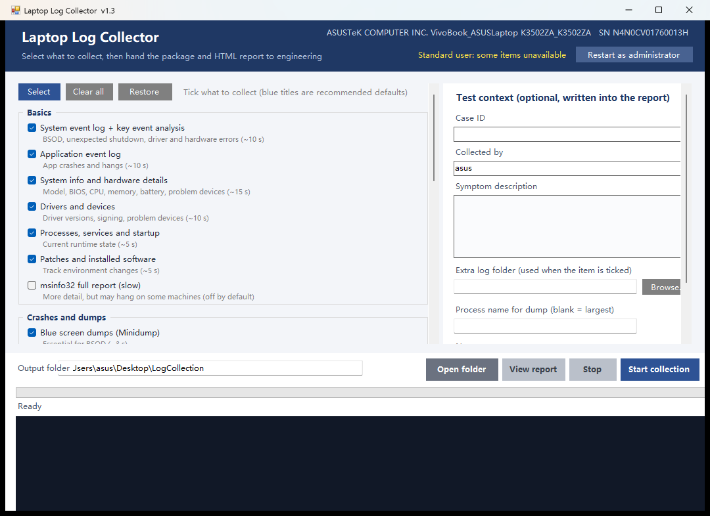

# Laptop Log Collector

A one-click log collection tool for Windows laptop testers. Tick the items you need; the tool
copies the logs, system information, crash dumps, power and performance data into one folder and
generates an HTML report that can be handed straight to engineering.

- Single portable exe, no .NET / Python / runtime required
- Read-only: does not clear logs, change settings or install anything
- Works offline; interface, reports and folder names are in English



## Branches

Every release gets its own branch; `main` always tracks the latest development state.

| Branch | Version | Notes |
|---|---|---|
| `main` | dev | latest code, may contain unreleased changes |
| `v1.7` | v1.7 | `C:\Windows\Panther`, `C:\Windows\Logs`, `C:\Windows\INF` mirrored with their folder structure |
| `v1.6` | v1.6 | WER and LiveKernelReports mirrored with their folder structure; `powercfg /spr` sleep-study report; SOURCE.txt in every folder |
| `v1.5` | v1.5 | new "All event log files (.evtx)" item: full mirror of `winevt\Logs` including empty folders (channel export fallback without admin); package folder named after the BIOS serial |
| `v1.4` | v1.4 | quick links to System.evtx / Application.evtx on the report; output path layout fix |
| `v1.3` | v1.3 | English UI, reports and folder names; all messages localised |
| `v1.2` | v1.2 | power/sleep timeout collection; HTML viewer (All_Content.html + browse.html) |
| `v1.1` | v1.1 | process memory dump; "skipped" instead of false success; dump-config diagnostics |
| `v1.0` | v1.0 | initial release; sources were overwritten before git was introduced |

New release: work on `main`, then `git branch vX.Y` and tag it with the same name.

## What it collects

| Group | Items |
|---|---|
| Basics | System event log + key event analysis, application event log, all .evtx files, system info and hardware details, drivers and devices, processes/services/startup, patches and installed software, msinfo32 (optional) |
| Crashes and dumps | Blue screen dumps (Minidump), WER crash reports (full `C:\ProgramData\Microsoft\Windows\WER` mirror), Live kernel reports (`C:\Windows\LiveKernelReports` mirror), MEMORY.DMP, process memory dump |
| Power and battery | Battery health report, power settings and wake sources (sleep/hibernate/display/disk timeouts, lid and power button action, hybrid sleep), energy report, sleep study + `powercfg /spr` system power report |
| Performance | Performance sampling (30 s), dxdiag graphics info |
| Network | Network configuration snapshot, Wi-Fi connection history |
| Storage | Disk and SMART health |
| Setup and component logs | Panther setup logs, `C:\Windows\Logs` (CBS/DISM/WindowsUpdate), `C:\Windows\INF` driver INFs and setupapi logs |
| Other | Extra log folder (custom path) |

## Output

Each run creates `<serial>_<timestamp>/` containing:

- `report.html` — key findings, event timeline, hardware, battery and power settings
- `All_Content.html` — every text file in one browsable page (sidebar + collapsible blocks)
- `browse.html` in each subfolder — that folder's text content in a browser
- `Collection_Info.txt` — what was collected, status and how to read it
- `SOURCE.txt` in every subfolder — source path, method and time for the files in it, so the package can be verified against the original logs
- Raw logs: `System.evtx`, `Application.evtx`, `*.dmp`, CSV/TXT exports

Text files are decoded as UTF-8, UTF-16 or GBK automatically, so Chinese output of system tools
still renders correctly.

## Build

No Visual Studio required — the .NET Framework compiler shipped with Windows is used:

```powershell
.\build.ps1
```

Output goes to `build\LogCollector.exe`.

## Command line

```
LogCollector.exe /cli /out:D:\logs /jobs:events-system,sysinfo,minidump
LogCollector.exe /cli /all /out:D:\logs /tag:SN1234567
LogCollector.exe /cli /out:D:\logs /jobs:pdump /proc:chrome.exe
```

Options: `/cli` headless, `/out` output folder, `/jobs` comma separated item ids, `/all` every item,
`/tag` package name prefix, `/case` case id, `/symptom` symptom text, `/proc` target process.

## Notes

- Temperature, fan speed and adapter identification need vendor WMI/EC interfaces — not available
  through standard Windows APIs.
- Blue screen dumps are produced by Windows, not by this tool. With "Small memory dump" configured
  no MEMORY.DMP is ever created; see `dist/User_Guide.txt` section 6.
- Process dumps can be several GB; the tool checks free space before copying large dumps.
- Collected packages may contain personal data (user names, paths, SSIDs). Handle them according to
  your data classification policy.
